# midstreamer-temporal-compare

[](https://crates.io/crates/midstreamer-temporal-compare)
[](https://docs.rs/midstreamer-temporal-compare)

Temporal sequence comparison and pattern matching for Rust: dynamic time warping (DTW), longest common subsequence (LCS), edit distance and Euclidean distance, with an LRU result cache. Part of [Midstream](https://github.com/ruvnet/midstream) by [rUv](https://ruv.io).



## Quickstart

```toml
[dependencies]
midstreamer-temporal-compare = "0.2"
```

```rust
use midstreamer_temporal_compare::{ComparisonAlgorithm, Sequence, TemporalComparator};

fn main() {
    // Cache up to 1,000 results; reject sequences longer than 10,000 elements.
    let cmp = TemporalComparator::<i32>::new(1_000, 10_000);

    let mut a = Sequence::new();
    let mut b = Sequence::new();
    for (t, v) in [1, 2, 3, 4, 5].into_iter().enumerate() {
        a.push(v, t as u64);
    }
    for (t, v) in [1, 2, 2, 3, 4, 5].into_iter().enumerate() {
        b.push(v, t as u64);
    }

    let dtw = cmp.compare(&a, &b, ComparisonAlgorithm::DTW).unwrap();
    let edit = cmp.compare(&a, &b, ComparisonAlgorithm::EditDistance).unwrap();
    println!("DTW distance:  {}", dtw.distance);
    println!("edit distance: {}", edit.distance);

    // Where does [3, 4, 5] occur in a longer series?
    let series = [9, 1, 3, 4, 5, 7, 3, 4, 6];
    for (start, dist) in cmp.find_similar(&series, &[3, 4, 5], 0.5) {
        println!("match at {start}, distance {dist:.2}");
    }
}
```

Output:

```text
DTW distance:  0
edit distance: 1
match at 2, distance 0.00
match at 6, distance 1.00
```

DTW absorbs the repeated `2`, so the distance is 0; edit distance counts it as one insertion.

## API

- `TemporalComparator::compare` runs one of `ComparisonAlgorithm::{DTW, LCS, EditDistance, Euclidean}` on two `Sequence`s and caches the result.
- `find_similar` and `detect_pattern` look for a needle in a longer series.
- `detect_recurring_patterns` and `detect_fuzzy_patterns` find repeated subsequences.
- `cache_stats` and `clear_cache` expose the result cache.

## License

MIT OR Apache-2.0
