# midstreamer

[](https://www.npmjs.com/package/midstreamer)
[](https://github.com/ruvnet/midstream)



WebAssembly time-series toolkit for Node.js and browsers: dynamic time warping, longest common subsequence and edit distance, a nanosecond scheduler, and StrangeLoop meta-learning.

## Features

- **Temporal Comparison**: Dynamic Time Warping (DTW), Longest Common Subsequence (LCS), and Edit Distance algorithms
- **Nanosecond Scheduler**: High-precision task scheduling with browser-based timing
- **Strange Loop**: Meta-learning and pattern recognition with self-improving algorithms
- **QuicMultistream**: simulated stream accounting (per-stream priority and byte counters in memory). It opens no sockets and does not speak QUIC.

## Installation

```bash
npm install midstreamer
```

## Quick Start

Save as `quickstart.mjs` and run `node quickstart.mjs` (Node.js 18+):

```javascript
import { init, TemporalCompare, StrangeLoop } from 'midstreamer';

await init();

const tc = new TemporalCompare(16);
const a = [1, 2, 3, 4, 5];
const b = [1, 2, 4, 5];
console.log('dtw:', tc.dtw(a, b));
console.log('lcs:', tc.lcs(a, b));
console.log('edit distance:', tc.editDistance('kitten', 'sitting'));

const loop = new StrangeLoop(0.1);
loop.observe('fast-path', 0.9);
loop.observe('slow-path', 0.4);
console.log('best pattern:', loop.bestPattern().patternId);
```

Output:

```text
[Midstream WASM] Initialized successfully
dtw: 1
lcs: 4
edit distance: 3
best pattern: fast-path
```

## Transport status (`midstreamer/quic`)

`midstreamer/quic` delegates to the transport loader of the optional peer
dependency [`agentic-flow`](https://www.npmjs.com/package/agentic-flow). No
published agentic-flow release (checked through 3.5.4) includes a native QUIC
binding, so `loadQuicTransport()` returns agentic-flow's **WebSocket fallback**
transport, not QUIC. Both probes report this:

```javascript
import { isQuicAvailable, isNative } from 'midstreamer/quic';

console.log('QUIC available:', await isQuicAvailable()); // false
console.log('native binding:', isNative());              // false
```

midstreamer releases up to 0.3.3 described this as "real QUIC transport" and
returned `true` from `isNative()`. Both were wrong and are corrected in 0.3.4.

## Usage

### Browser

```html
<!DOCTYPE html>
<html>
<head>
  <script type="module">
    import { init, TemporalCompare, NanoScheduler, StrangeLoop } from 'midstreamer';

    async function main() {
      // Initialize WASM module
      await init();

      // Temporal comparison
      const temporal = new TemporalCompare();
      const seq1 = [1, 2, 3, 4, 5];
      const seq2 = [1, 3, 4, 5];

      const metrics = temporal.analyze(seq1, seq2);
      console.log('Similarity:', metrics.similarityScore);

      // Nanosecond scheduler
      const scheduler = new NanoScheduler();
      scheduler.start();

      scheduler.schedule(() => {
        console.log('Task executed!');
      }, 1000000000); // 1 second in nanoseconds

      // Meta-learning
      const loop = new StrangeLoop(0.1);
      loop.observe('pattern-a', 0.8);
      loop.observe('pattern-b', 0.6);

      const best = loop.bestPattern();
      console.log('Best pattern:', best.patternId);
    }

    main();
  </script>
</head>
<body>
  <h1>Midstream WASM Demo</h1>
</body>
</html>
```

## API Reference

### Initialization

#### `init(wasmPath?: string): Promise<void>`

Initialize the WASM module. Must be called before using any other API.

```javascript
await init();
```

### TemporalCompare

Temporal sequence comparison algorithms.

#### Constructor

```javascript
const temporal = new TemporalCompare(windowSize?: number);
```

#### Methods

- `dtw(seq1: number[], seq2: number[]): number` - Dynamic Time Warping distance
- `lcs(seq1: number[], seq2: number[]): number` - Longest Common Subsequence length
- `editDistance(s1: string, s2: string): number` - Levenshtein edit distance
- `analyze(seq1: number[], seq2: number[]): TemporalMetrics` - Comprehensive analysis

### NanoScheduler

High-precision task scheduler with nanosecond timing.

#### Constructor

```javascript
const scheduler = new NanoScheduler();
```

#### Methods

- `schedule(callback: () => void, delayNs: number): number` - Schedule one-time task
- `scheduleRepeating(callback: () => void, intervalNs: number): number` - Schedule repeating task
- `cancel(taskId: number): boolean` - Cancel a task
- `nowNs(): number` - Get current time in nanoseconds
- `start(): void` - Start processing tasks
- `stop(): void` - Stop the scheduler

#### Properties

- `pendingCount: number` - Number of pending tasks

### StrangeLoop

Meta-learning and pattern recognition with self-improvement.

#### Constructor

```javascript
const loop = new StrangeLoop(learningRate?: number);
```

#### Methods

- `observe(patternId: string, performance: number): void` - Learn from observation
- `getConfidence(patternId: string): number | null` - Get pattern confidence
- `bestPattern(): MetaPattern | null` - Get best learned pattern
- `reflect(): Record<string, MetaPattern>` - Get all patterns (meta-cognition)

#### Properties

- `iterationCount: number` - Total learning iterations
- `patternCount: number` - Number of learned patterns

### QuicMultistream

Simulated stream accounting: keeps per-stream priority and byte counters in memory. `send` counts bytes and `receive` returns zero-filled buffers; nothing goes over a network.

#### Constructor

```javascript
const quic = new QuicMultistream();
```

#### Methods

- `openStream(priority?: number): number` - Open new stream
- `closeStream(streamId: number): boolean` - Close stream
- `send(streamId: number, data: Uint8Array): number` - Send data
- `receive(streamId: number, size: number): Uint8Array` - Receive data
- `getStats(streamId: number): StreamStats | null` - Get stream statistics

#### Properties

- `streamCount: number` - Number of active streams

### Utilities

- `version(): string` - Get WASM module version
- `benchmarkDtw(size?: number, iterations?: number): number` - Benchmark DTW performance

## Performance

The WASM implementation provides significant performance improvements:

- **DTW**: ~100x faster than pure JavaScript
- **LCS**: ~50x faster than pure JavaScript
- **Scheduler**: Microsecond precision using browser Performance API
- **Binary size**: ~80KB (gzipped)

## Browser Compatibility

- Chrome 87+
- Firefox 89+
- Safari 15+
- Edge 88+

Requires WebAssembly support.

## Examples

See the `examples/` directory for complete demonstrations:

- `demo.html` - Interactive browser demo
- `scheduler-demo.html` - Nanosecond scheduler visualization
- `meta-learning-demo.html` - Real-time meta-learning
- `performance-test.html` - Performance benchmarks

## Building from Source

```bash
# Install dependencies
npm install

# Build WASM for all targets
npm run build

# Development mode with hot reload
npm run dev

# Run tests
npm test

# Clean build artifacts
npm run clean
```

## License

MIT OR Apache-2.0

## Contributing

Contributions welcome! Please see the main Midstream repository for guidelines.

## Links

- [GitHub repository](https://github.com/ruvnet/midstream)
- [Issues](https://github.com/ruvnet/midstream/issues)
- [ruv.io](https://ruv.io)
